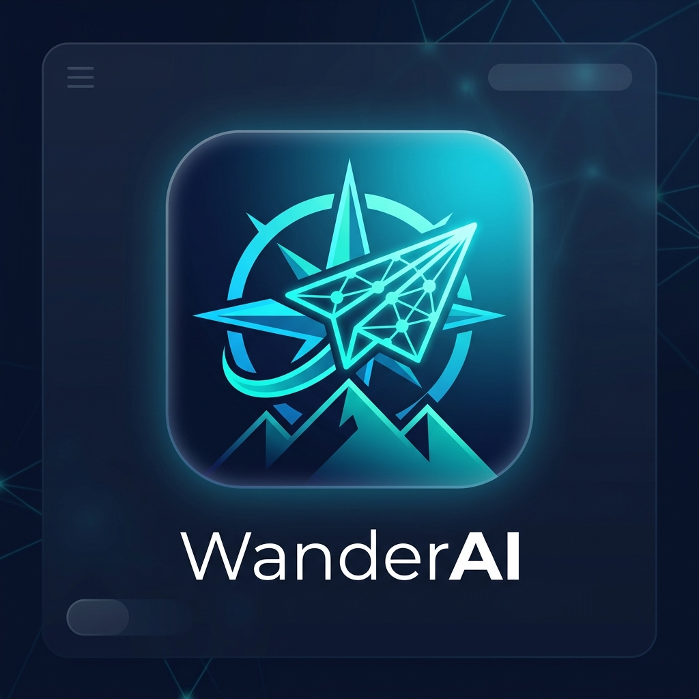
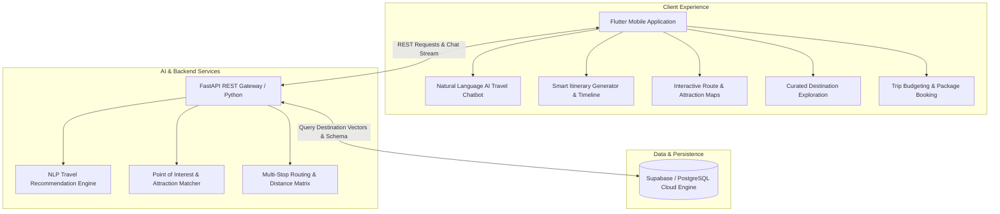
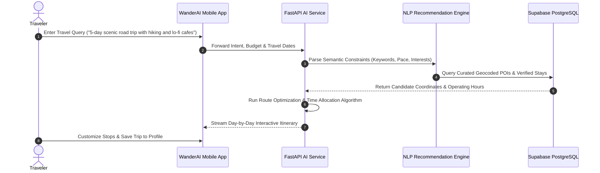

<div align="center">



# WanderAI Assistant

### Autonomous AI Travel Companion, Dynamic Itinerary Planner & Smart Route Navigator

[](https://flutter.dev)
[](https://dart.dev)
[](https://python.org)
[](https://fastapi.tiangolo.com)
[](https://supabase.com)
[](LICENSE)

<p align="center">
  <b>WanderAI</b> is a full-stack, AI-driven personal travel concierge and autonomous itinerary builder. Powered by a natural language processing (NLP) recommendation backend, multi-stop routing algorithms, Points of Interest (POI) clustering, and an interactive cross-platform Flutter client.
</p>

</div>

---

## 🌟 Platform Architecture

WanderAI connects modern travelers with personalized destinations, scenic attractions, and real-time smart itineraries generated on the fly.



---

## ✈️ Intelligent Itinerary Generation Workflow



---

## ✨ Core Features

### 🤖 1. Natural Language Travel AI
- **Conversational Concierge:** Ask questions like *"What are 3 quiet sunset viewpoints along my drive?"* or *"Plan a weekend getaway under $500."*
- **Contextual Personalization:** Adapts suggestions based on user travel style (Solo Backpacker, Family, Luxury, Adventurer).

### 🗺️ 2. Dynamic Routing & Attraction Discovery
- **Multi-Stop Route Optimizer:** Automatically sequences waypoints to minimize travel fatigue and backtracking.
- **En-Route Discovery:** Highlights hidden gems, scenic lookouts, and historic landmarks directly along the active route.

### 💼 3. Comprehensive Trip Management
- **Interactive Day Cards:** Time-budgeted schedules with travel duration estimates between each activity.
- **Saved Collections:** Bookmark dream destinations and create customized bucket lists.
- **Offline Readiness:** Cached trip itineraries accessible even when venturing off the grid.

---

## 📁 Repository Structure

```
WanderAI-Assistant/
├── assets/
│   └── branding/
│       └── logo.jpg               # Official brand asset
├── backend/                       # Python FastAPI Backend
│   ├── main.py                    # API entry point & route definitions
│   ├── nlp_service.py             # Natural language intent & recommendation processor
│   ├── poi_service.py             # Point of interest clustering & ranking
│   ├── routing_service.py         # Multi-stop travel routing logic
│   ├── database.py                # Supabase PostgreSQL client integration
│   ├── schema.sql                 # Database relational schema
│   └── requirements.txt
├── lib/                           # Flutter Cross-Platform Client
│   ├── main.dart                  # Application bootstrap
│   ├── core/                      # API service, routing, auth, and theme tokens
│   ├── screens/                   # Itinerary cards, AI chat, explore, and booking views
│   └── widgets/                   # Chat bubbles, route cards, destination components
├── test/                          # Unit and widget test suite
└── README.md
```

---

## 🚀 Getting Started

### 1. Backend AI Service Setup
```bash
cd backend
python3 -m venv venv
source venv/bin/activate
pip install -r requirements.txt

# Configure environment variables
cp .env.example .env

# Run FastAPI development server
uvicorn main:app --reload --port 8000
```

### 2. Flutter Mobile Application
```bash
# In the root directory
flutter pub get

# Launch on connected mobile device or simulator
flutter run
```

---

## 🔒 Confidentiality & White-Label Notice
This repository is an open-source demonstration and portfolio showcase. All proprietary client data, commercial vendor contracts, live API tokens, and client credentials have been sanitized and decoupled.

---

## 👨‍💻 Author
**Muhammad Ali**
- GitHub: [@itismemuhammadali](https://github.com/itismemuhammadali)
- Portfolio & Engineering Showcase
